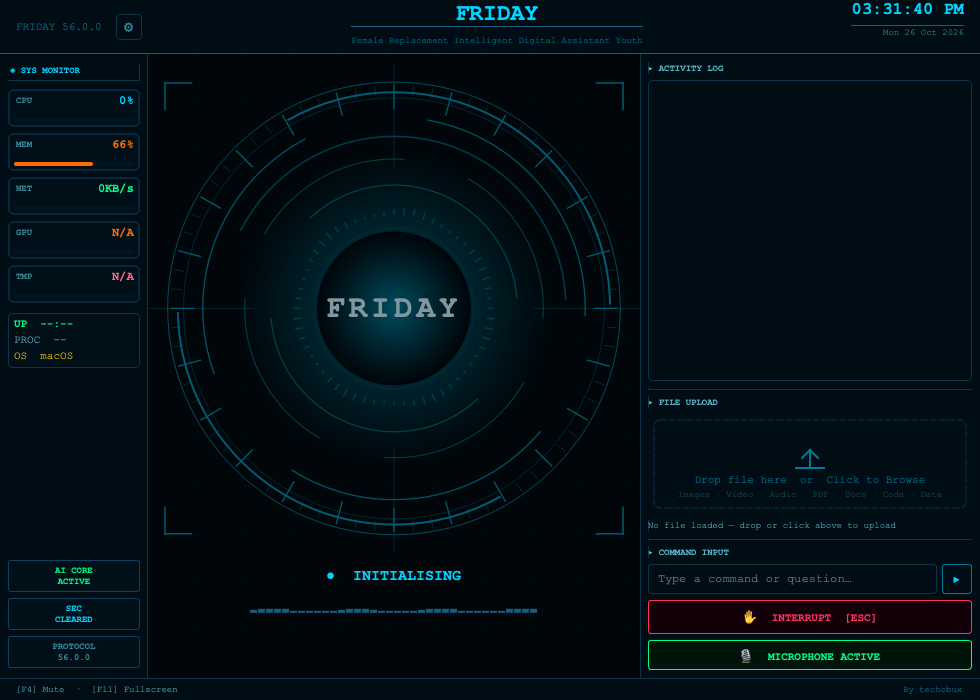
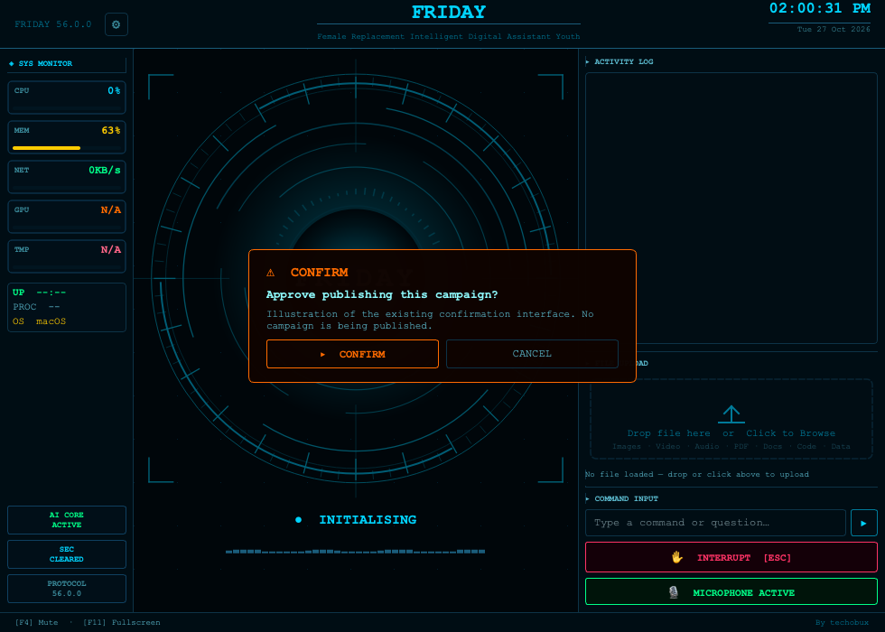

# FRIDAY for Windows

**A voice-controlled desktop assistant by techobux.**

FRIDAY keeps its original HUD and voice interaction while bringing computer tools, browser tasks and marketing workflows into one assistant.

## What is included

- Voice conversations and the offline Friday wake recognizer.
- Mouse, keyboard, desktop and browser automation tools.
- AI-service task coordination, saved jobs, progress, resume and cancellation.
- Brand context, competitor research and marketing/ecommerce task tools.
- File and document processing, download verification and CSV marketing metrics.
- Confirmation controls for protected actions.

Features depend on your operating system, permissions, service availability and configured accounts. FRIDAY reuses supported existing browser sessions; login and CAPTCHA may require your input. Its conversational brain requires the service configuration offered in the app. Using an AI website does not remove that service's subscription or account requirements.

## Original interface

The assistant remains voice-first. The image below illustrates its confirmation interface; it is not evidence of a live campaign being published.

Example requests:

> “Friday, research competitors for my product.”
>
> “Friday, use Gemini to create a product image and save the result.”
>
> “Friday, tell me the status of my current job.”

These are intended workflows. Successful completion depends on the website, account access and available tools; this repository does not claim that every third-party workflow has passed live acceptance testing.

## Windows installer

The build target is **FRIDAY_Setup_56.0.0_x64.exe**, for Windows 10 build 19041 or later and Windows 11 on x64 machines.

Customers use an installation wizard and launch FRIDAY from the Start Menu. No Python or source-code setup is required for customers. Accounts and credentials are configured on their own computer, never bundled in the installer.

The [Windows Actions workflow](../../actions) builds the executable, creates the setup wizard and checks installation, offline launch and uninstallation. After a successful run, download the **FRIDAY-56.0.0-Windows-Setup** artifact. It contains the EXE, checksum and build manifest. An artifact is not a published release; check Actions for the actual build result.

**Validation:** 48 local tests passed with 2 skips before publication. Native Windows compilation and acceptance results are reported by Actions. Live microphone, signed-in browser and ecommerce workflows still require testing on Windows. The installer is currently unsigned.

Developer build instructions: [Windows packaging guide](packaging/windows/README.md).

## Ownership and dependencies

Copyright © techobux. All rights reserved. Public visibility does not grant an open-source license. See [LICENSE](LICENSE) and [third-party notices](THIRD_PARTY_NOTICES.md).

The offline Vosk model is downloaded from its official source during CI and verified against a pinned SHA-256 checksum. API keys, personal memories, browser sessions, generated customer files and local environments are excluded from this repository.
